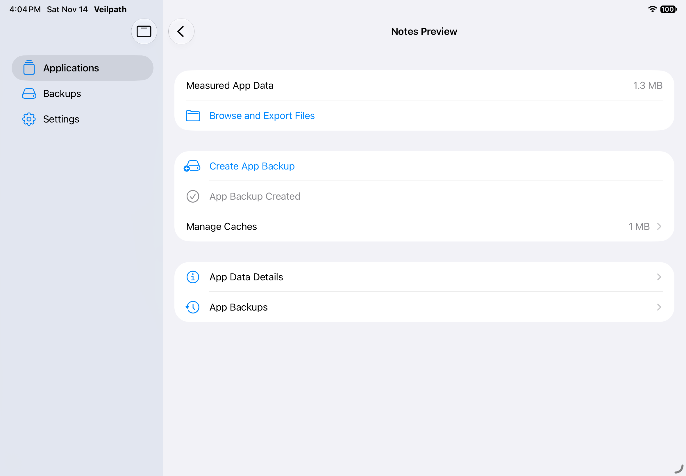
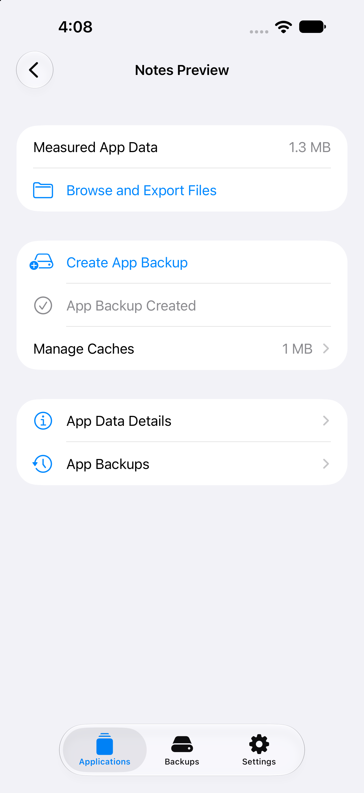

<p align="center">
  
</p>

<h1 align="center">Veilpath</h1>

<p align="center">
  English · <a href="README.zh-CN.md">简体中文</a>
</p>

<p align="center">
  A native app data workspace for iPhone and iPad,<br>
  with <a href="https://github.com/forcequitOS/bad_query"><code>bad_query</code></a> and <a href="https://github.com/forcequitOS/worse_query"><code>worse_query</code></a> access backends.
</p>

<p align="center">
  <a href="https://xnu.app/veilpath/">Website</a> ·
  <a href="https://github.com/everettjf/veilpath/releases/tag/v1.2.0">Download preview</a> ·
  <a href="https://discord.gg/eGzEaP6TzR">Discord</a> ·
  <a href="#compatibility">Compatibility</a> ·
  <a href="#building">Build</a> ·
  <a href="#acknowledgements">Acknowledgements</a>
</p>

> [!IMPORTANT]
> **Supported versions: iOS / iPadOS 26 through 27 beta 3.** The complete
> `bad_query` access path has been validated on a physical iPad Air running
> **iPadOS 27 beta 3 (`24A5380l`)**. Both backends and default automatic selection
> have also passed the supported checks on **iPhone 11, iOS 26.0.1 (`23A355`)**.
> A physical device is required; Simulator builds validate compilation, UI,
> and local fixtures only. The legacy `bad_query` proof of concept lists
> support through iOS 26.6.1 and iOS 27 beta 4, but those additional versions
> have not all been validated in Veilpath.

<table>
  <tr>
    <td width="68%"></td>
    <td width="32%"></td>
  </tr>
</table>

Screenshots use disposable simulator examples of the v1.2.0 interface.

## What is Veilpath?

Veilpath organizes app data around three sections: Applications, Backups, and
Settings. Find an app, browse or export its files, inspect its storage, and save
or restore a backup. Cache cleaning always preserves a verified recovery copy.
Private-container exploration and guarded file writes live in Advanced Tools.
The access techniques apply only to the documented compatible OS versions.

The name **Veilpath** combines **veil** and **path**: a route into data that is
normally hidden behind an app's sandbox boundary. It reflects the project's
focus on deliberate exploration while keeping every write guarded and
recoverable.

## Highlights

- Native SwiftUI interface that adapts to iPad and iPhone.
- Opens on one searchable application list with measured data and cache sizes.
  App details lead to files, backups, cache management, and optional technical details.
- Indexes Application, App Group, PluginKit, Internal Daemon, System Data, and
  System Group containers.
- Resolves container UUIDs to readable bundle identifiers using container
  metadata, and shows application names when a verified name is available.
- Keeps App and cache recovery backups together, grouped by app, with archive
  storage totals, verified import/export and restore, and confirmed manual deletion.
- Loads applications after an access check. Whole-library storage scanning and
  the full diagnostic suite run on demand; opening an app scans only that app.
- Falls back to `fsgetpath` inode discovery when a container root cannot be
  opened directly.
- Acquires a sandbox extension for each operation and releases it immediately
  afterward.
- Automatically chooses between `worse_query` and `bad_query`, with grant-time
  fallback and no manual backend selector.
- Browses with directory history, back/forward/up navigation, local filtering,
  recursive container search, and name/date/size sorting.
- Previews searchable plist and JSON trees, XML, text, images, PDF, and archives.
  Hex, SQLite, Mach-O, absolute paths, and guarded write tools are in advanced workspaces.
- Opens an app-specific iPad workspace with the current file list beside file
  properties, then a resizable 60–90% preview that can expand full screen.
- Uses a focused flow on iPhone: App details, file list, then full-screen
  preview, with file information presented separately.
- Shows ordinary file metadata; advanced workspaces expose technical properties
  and SHA-256 values. Verification remains enabled in both workflows.
- Prepares files on demand for sharing, streaming large copies in 1 MiB chunks
  with progress, cancellation, verification, and automatic cache expiry.
- Archives the current folder or a selected folder as ZIP while preserving empty
  directories, honoring the hidden-file setting, and skipping symbolic links.
- Provides advanced multi-select file operations: copy, cut, paste, duplicate,
  batch ZIP compression, ZIP/IPA extraction, and guarded deletion. Deletes first
  create a uniquely named recoverable safety archive. Batch operations report
  per-item failures and preserve failed selections or cut sources for retry.
- Extracts stored and Deflate ZIP entries with bounded streaming I/O. Extraction
  verifies paths, sizes, and CRC-32, checks free space, rejects encrypted links,
  oversized output, and suspicious expansion ratios, and cleans partial output
  when cancelled.
- Exports a complete Application data backup containing `Documents`, `Library`,
  `tmp`, and `manifest.json`. Every file is recorded with its SHA-256 digest.
- Restores complete App backups only after validating the bundle identifier,
  exact root structure, declared payload, file sizes, and every SHA-256. A newly
  created backup is extracted and verified before success is reported. Restore
  blocks Veilpath's own live container, checks staging space, and first preserves the
  current container as a safety backup, stages the replacement, and rolls back
  if the directory swap fails.
- Keeps ordinary browsing read-only; advanced workspaces allow guarded JSON and plist
  edits, versioned backup and replacement, SHA-256 verification, and restore
  with a fresh safety backup.
- Includes an on-demand on-device diagnostics suite with a structured JSON report.

## App storage and backups

The **Applications** list combines app names and storage results. Start a scan
when needed to sort by measured size, or open an app to scan only its data.
**App Data Details** separates Documents, Library data, Caches,
temporary files, and other files. These are logical file sizes, not allocated
disk usage. Scans are cancellable; unreadable or bounded scans are marked
partial and cannot enable cleaning.

Application names combine available system API results, localized names for
common Apple apps, and bounded, read-only LaunchServices metadata matching.
Database names must match both the independently discovered container path and
bundle identifier. Parsing stays in memory; the raw database is neither saved
nor exported. Unknown names retain their exact bundle identifier. Name coverage
depends on the device and OS build.

In an app's **Manage Caches** screen, **Back Up and Clean Caches** selects only
`Library/Caches`; `tmp` is opt-in. Close the target app first. Veilpath creates a
compressed recovery archive, re-extracts it, verifies CRC-32 and SHA-256, and
checks that the source has not changed before replacing the selected roots.
Documents and app settings remain outside this operation. Links and unsupported
files stop cleanup. The current recovery archive limit is 4 GB and 65,535 ZIP
entries. Veilpath's own active data container is protected.

Cleanup uses staged directory renames and a persisted journal. Interrupted
transactions are recovered before further app data operations; unexpected
concurrent data stops recovery and preserves the backup and staged files.
Cancellation does not interrupt rollback. Results distinguish source bytes
removed, recovery archive size, and the measured change in available space.
Keeping a recovery copy consumes storage, so the removed byte count is not a
promise of net free space. Return to the app details to **Undo This Cleanup**;
restoring first saves the current cache state as another safety copy.

**Backups** keeps full App backups and cache recovery archives in
Veilpath's own Documents directory without automatic expiry. It can create
backups, import supported ZIP backups after complete validation, export an
individual verified archive through Veilpath's share cache, and restore to a
currently matching app container. Restore creates a fresh safety backup in the
same center, labeled **Before Restore**. Full App backups contain Documents,
Library, and tmp with a SHA-256 manifest; symbolic links are excluded and their
count is shown when known. These are container file backups, not complete device
or Keychain backups. Retained archives also need space on the device. The list
shows total archive bytes and groups recovery points by app. Delete an individual
backup only after a separate confirmation; active recovery journals, preserved
staging, links, and unexpected contents block deletion. Deletion removes that
selected recovery copy permanently and does not create another backup of it.
Complete interrupted removals are returned to the library for confirmation;
partial or unexpected remnants are preserved for attention.

Settings → **Advanced Tools** holds other container categories, diagnostics,
technical previews, and guarded file operations. Grid/list customization,
directory Markdown export, filename web search, automatic screenshot feedback,
and dedicated font/cookie preview screens have been removed.

Wallpapers and themes are reserved for a later phase. MobileGestalt modification
tools are not part of this workflow and require separate model and OS validation.

## Compatibility

Veilpath's stated support range is intentionally limited to versions covered by
its implementation and testing. **Do not assume that a newer beta or release is
compatible solely because the app builds.** Run the on-device self-test after
installing Veilpath; private Container Manager behavior may change between OS
builds.

| Platform | Target | Validation |
| --- | --- | --- |
| iPadOS | 27 beta 3 (`24A5380l`) | Fully tested on physical iPad Air (`iPad15,3`) |
| iOS / iPadOS | 26.x | Deployment target and App Group compatibility path |
| iPhone 11 | 26.0.1 (`23A355`) | Schema 24 Automatic: 23 passed, 3 unsupported, 0 failed; earlier schema 22 verified both forced backends |
| iPhone | 27 beta 3 (`24A5390f`) | Fully tested on physical iPhone 17 Pro (`iPhone18,1`) |
| Simulator | 26–27 | UI and local fixtures only; both access backends require a physical device |

The legacy bad_query upstream currently describes support through iOS 26.6.1 and iOS
27 beta 4. Veilpath deliberately documents the narrower range that has been
implemented and validated here: **iOS/iPadOS 26 through 27 beta 3**. Versions
outside this range are unsupported until confirmed by physical-device testing.

### Access backends

Veilpath automatically chooses its access backend. It initially prefers
worse_query, remembers a working backend for each container category during the
session, and falls back to bad_query when acquiring access fails. There is no
manual backend selector, and preferences saved by earlier builds are ignored.
The last backend that actually granted access is recorded in Diagnostics.
Debug builds retain backend overrides for regression testing only.

Both backends keep per-operation grants and share the existing backup,
validation, verification, and rollback safeguards. A failed file operation is
never replayed through another backend. worse_query requires a usable signed
App Group for every request; Veilpath preserves its cache directory by renaming
it before staging the temporary link, serializes requests, and recovers an
interrupted workspace before use. Original cache contents are never deleted.

The worse_query upstream declares iOS 26.0–26.7.2 and 27.2 support. That is an
upstream claim, not an expanded Veilpath compatibility guarantee. On iOS 26,
System Data and System Group capabilities remain unavailable. On a physical
iPhone 11 running iOS 26.0.1 (`23A355`), developer tests of both forced backends
and default automatic selection passed the supported
schema 22 checks, including external App Group metadata preview/export and
temporary-fixture backup/restore tests. Automatic selected worse_query. The new
backend has not yet been verified in Veilpath on iOS 27 devices.

### Physical-device diagnostics

Veilpath includes an on-device regression suite that verifies sandbox access,
container discovery, structured preview, file analysis, Mach-O parsing,
streamed sharing, ZIP policy, stored and Deflate extraction, multi-item file
operations, cancellation cleanup, guarded editing, complete
App backup and rollback-safe restore, and local search. Schema 23 added bounded
application-name parsing, read-only on-device storage scanning, and recoverable
cache cleanup with import, restore, interrupted recovery, and corruption tests.
Schema 24 replaces directory Markdown coverage with guarded backup deletion,
including interrupted removal, cancellation, link refusal, and preservation of
live data and other backups. Full diagnostics are available on demand from
Settings → Advanced Tools. The iPhone 11 automatic-mode run passed 23 checks, with 3 unsupported iOS 26
capabilities and no failures. The simulator passed 16 local-fixture checks.
Mutation tests use Veilpath's own disposable fixtures; other apps are only scanned
read-only. The new app-management flows have physical-device validation on iOS
26.0.1 only. Reports retain the selected and last granted backends, and older
reports remain decodable. Results are written to
`Documents/veilpath-self-test.json` inside Veilpath's own data container. Container
counts are intentionally not presented as project-wide metrics because they
depend entirely on the apps and system state of each device.

## Building

### Requirements

- Xcode 27 beta
- iOS or iPadOS 26.0 or newer
- An Apple development team for device signing
- A physical device for testing sandbox access

### Steps

1. Clone the repository:

   ```sh
   git clone https://github.com/everettjf/veilpath.git
   cd veilpath
   ```

2. Open `Veilpath.xcodeproj`.
3. Select the `Veilpath` scheme and an iPhone or iPad destination.
4. Choose your development team under **Signing & Capabilities**.
5. Build and run.

Veilpath uses the App Group identifier `group.com.xnu.veilpath` for every
worse_query request and the legacy iOS 26 App Group access path. If you build under a different bundle identifier or
team, replace it with an App Group owned by your account in both
`Veilpath/Veilpath.entitlements` and `Veilpath/Core/SandboxAccessClient.swift`.

The backend and workspace regression checks can also run on macOS without
a device (using test-only bridge stubs):

```sh
xcrun swiftc -D DEBUG Veilpath/Core/WorseQueryWorkspace.swift \
  Veilpath/Core/SandboxAccessClient.swift tests/SandboxAccessTests.swift \
  -o /tmp/veilpath-access-tests
/tmp/veilpath-access-tests
```

## Packaging and installation channels

The [v1.2.0 preview release](https://github.com/everettjf/veilpath/releases/tag/v1.2.0)
includes the re-signing IPA, matching source archive, build record, checksums, and
licensing notices. Choose `Veilpath-1.2.0-3-resign.ipa` for sideloading. The
device-restricted development IPA is kept private because its embedded profile
contains registered-device identifiers. Installer-specific validation and the
documented licensing boundary remain unresolved; this is an experimental preview.

**Public releases contain only the re-signing IPA**, intended for AltStore
Classic, SideStore, Sideloadly, or another compatible installer that signs the
app with the user's account. Development and Apple Ad Hoc signed IPAs are local
testing artifacts and are never public Release attachments. They are tied to
provisioned devices and can contain registered-device identifiers. Source,
non-sensitive build metadata, checksums, and licensing notices accompany the
public IPA; signing credentials and build logs do not.

Use `python3 scripts/package.py` on a Mac with Xcode to create a **Release,
arm64, iPhoneOS** IPA. Outputs must be outside the repository. The script checks
ZIP CRCs, the executable architecture, code-signature structure, and the App
Group entitlement, then writes a JSON build record and SHA-256 checksum beside
the IPA. It never uploads packages, credentials, or provisioning files.

| Channel | Package | Status |
| --- | --- | --- |
| AltStore Classic / SideStore / Sideloadly | `resign.ipa` | Packaging supported; installation and access must be verified after each tool re-signs it |
| Xcode / Device Hub / Apple Configurator | `development.ipa` (private) | Local testing only; requires a valid profile covering the target device and App Group |
| Apple Ad Hoc testing | `ad-hoc.ipa` (private) | Local testing only; requires distribution signing assets and registered devices |
| TrollStore | None | Official supported OS versions do not overlap Veilpath's iOS 26 minimum |
| AltStore PAL / TestFlight / App Store | Separate reviewed distribution | Not produced by this script; an ordinary IPA is not a notarized marketplace package |

Create the package that a sideloading tool will re-sign with the user's account:

```sh
python3 scripts/package.py --mode sideload --output /tmp/veilpath-packages
```

The `Veilpath-<version>-<build>-resign.ipa` has an ad hoc code signature carrying
the requested App Group entitlement, with no embedded developer profile. This
is **not** Apple Ad Hoc distribution signing and cannot be installed directly
on a stock device. All three sideloading tools can consume IPA files; their
ability to provision the required App Group and execute both access backends
in Veilpath still needs on-device channel testing.

For local testing with the team's registered devices:

```sh
python3 scripts/package.py --mode development --output /tmp/veilpath-packages
# With suitable Apple Distribution assets and registered test devices:
python3 scripts/package.py --mode ad-hoc --output /tmp/veilpath-ad-hoc
```

Signed exports use the project's team by default; `--team-id` can override the
team, which must own the configured bundle ID and App Group. Xcode may update
provisioning assets during signed exports. These IPAs contain an embedded
profile with signing and permitted-device information: keep local development
packages private. Output names are never overwritten. There is no simulator IPA.

The exported development IPA was unpacked and installed on the connected iPhone
11, iOS 26.0.1 (`23A355`); its Release build passed 23 schema 23 checks with 3
unsupported capabilities and no failures. This validates the development export,
not an AltStore, SideStore, Sideloadly, or Apple Ad Hoc installation. App Group
mapping acceptance/refusal also has standalone regression coverage.

Keep `group.com.xnu.veilpath` in the requested entitlements. AltStore appends its
team identifier and records groups in `ALTAppGroups`; Veilpath accepts one
accessible mapping of its own group, while keeping the original group preferred
when accessible. Unrelated, malformed, inaccessible, or ambiguous mappings are
not used. Other signers must preserve the group or provide the same supported
mapping. After installation, run Settings → Advanced Tools → Diagnostics and Logs: launching the app alone
does not verify access, App Group staging, or recovery. Keep a stable account,
bundle ID, and installation channel for upgrades; export retained backups before
changing these identities or uninstalling.

An AltStore Classic source can later point at a hosted re-signing IPA with its
real version, build number, byte size, and App Group permission declaration.
No source with a placeholder download link or automatic binary release is
published here. Public redistribution remains subject to the unresolved
licensing boundary in [LICENSING.md](LICENSING.md).

References: [AltStore Classic versus PAL](https://faq.altstore.io/altstore-pal-v.-altstore-classic),
[AltStore source format](https://faq.altstore.io/developers/make-a-source),
[SideStore documentation](https://docs.sidestore.io/),
[Sideloadly](https://sideloadly.io/), [TrollStore compatibility](https://github.com/opa334/TrollStore),
and [Apple registered-device distribution](https://developer.apple.com/documentation/xcode/distributing-your-app-to-registered-devices).

## Project structure

```text
Veilpath.xcodeproj/          Xcode project
Veilpath/
  BadQuery/                 Legacy C sandbox-extension primitive
  WorseQuery/               App Group query bridge and upstream license
  Containers/               Container indexing and metadata resolution
  Core/                     File access, preview, storage, guarded backup and recovery
  Diagnostics/              On-device regression suite
  Model/                    Observable application state
  ContentView.swift         Adaptive iPad/iPhone interface
  AppManagementView.swift   App Storage and Backup Center
docs/                       GitHub Pages website
tests/                      Standalone backend and workspace regression checks
scripts/package.py          Local Release IPA packaging and validation
```

Contributor instructions, validation commands, and access safeguards are in
[`AGENTS.md`](AGENTS.md). Keep the English and Simplified Chinese documentation
and the GitHub Pages site aligned when changing public behavior or compatibility.

## Safety and scope

Veilpath is experimental security-research software. It relies on private APIs
and behavior that can differ between OS builds. Use it only on devices and data
you own or are explicitly authorized to test.

Browsing, previews, search, and export remain read-only. Write operations require
an explicit user action. Structured edits use a temporary draft, validation,
Version Vault history, and SHA-256 verification. File deletion first creates a
recoverable ZIP; operation safety archives are retained for up to 30 days with
at most 10 archives in each category. This expiry policy does not apply to
Backup Center's retained App and cache recovery backups. Complete App restore validates the manifest and every payload
hash, saves the current `Documents`, `Library`, and `tmp`, stages the replacement,
then performs a rollback-capable directory swap. This is still sensitive research
software; an in-app backup reduces risk but is not a substitute for a device
backup. Diagnostics report failures explicitly instead of assuming a path is
accessible.

## Acknowledgements

Veilpath exists because of the original
[`forcequitOS/bad_query`](https://github.com/forcequitOS/bad_query) sandbox
escape proof of concept. Thank you to **forcequitOS** and the project's
contributors for researching the issue and publishing a clear implementation
for the community.

The low-level container-query approach in Veilpath is derived from that work.
Please credit and support the upstream project when reusing or extending it.

The additional [`forcequitOS/worse_query`](https://github.com/forcequitOS/worse_query)
backend is derived from Taj C (forcequit)'s work and retains its GPL-3.0-or-later
notice and license in `Veilpath/WorseQuery/`.

## Licensing status

See [`LICENSING.md`](LICENSING.md) for the exact file boundary, release checklist,
and a ready-to-send upstream clarification request.

The upstream `bad_query` repository does not currently declare an open-source
license. Consequently, the derived files under `Veilpath/BadQuery/` are **not**
implicitly covered by a permissive license, and this repository intentionally
does not claim otherwise.

Before assigning a single open-source license to the complete repository,
obtain permission or a license clarification from the upstream author. The
remaining original Veilpath code can be licensed separately once that boundary
is documented explicitly.

## Disclaimer

This project is provided for research and development. There is no warranty of
compatibility, reliability, or fitness for a particular purpose. Apple can
change or remove the private behavior Veilpath depends on at any time.
