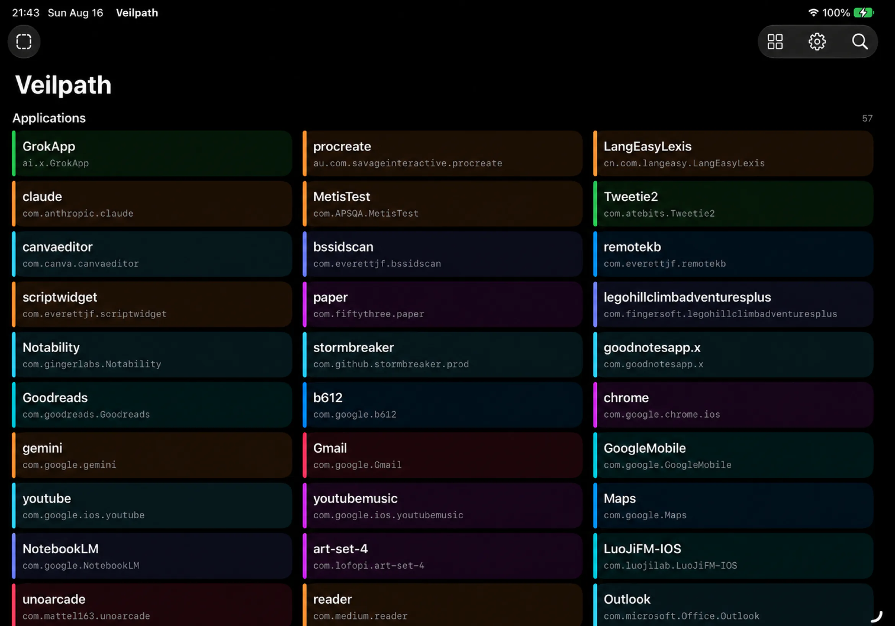
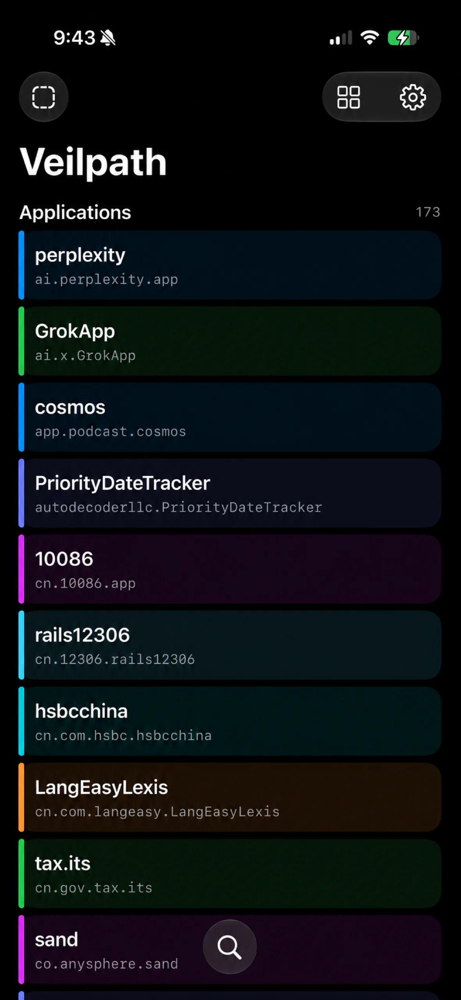

<p align="center">
  
</p>

<h1 align="center">Veilpath</h1>

<p align="center">
  <a href="README.md">English</a> · 简体中文
</p>

<p align="center">
  一款适用于 iPhone 和 iPad 的原生容器浏览器与受保护文件工作区，<br>
  支持 <a href="https://github.com/forcequitOS/bad_query"><code>bad_query</code></a> 和 <a href="https://github.com/forcequitOS/worse_query"><code>worse_query</code></a> 双访问后端。
</p>

<p align="center">
  <a href="https://xnu.app/veilpath/">网站</a> ·
  <a href="https://discord.gg/eGzEaP6TzR">Discord</a> ·
  <a href="#兼容性">兼容性</a> ·
  <a href="#构建">构建</a> ·
  <a href="#致谢">致谢</a>
</p>

> [!IMPORTANT]
> **支持版本：iOS / iPadOS 26 至 27 beta 3。** 完整的 `bad_query` 访问路径
> 已在运行 **iPadOS 27 beta 3（`24A5380l`）** 的 iPad Air 真机上验证。
> 两个后端及默认自动选择也已在 **iPhone 11、iOS 26.0.1（`23A355`）** 上通过
> 支持范围内的检查。实际功能必须使用真机，模拟器验证编译、界面及本地测试数据。
> 旧版 `bad_query` 概念验证项目标注支持
> 至 iOS 26.6.1 和 iOS 27 beta 4，但这些额外版本尚未全部经过 Veilpath 验证。

<table>
  <tr>
    <td width="68%"></td>
    <td width="32%"></td>
  </tr>
</table>

## Veilpath 是什么？

Veilpath 将 `bad_query` 和 `worse_query` 概念验证项目转化为一个专注于文件探索的界面，
适用于该技术能够生效的 iOS 和 iPadOS 版本。它可以发现通常无法访问的容器、
解析容器标识符，并可查看、导出文件，或在具备校验、备份与恢复路径的前提下，
有意识地替换单个文件。

**Veilpath** 结合了 **veil**（面纱）与 **path**（路径）：它是一条通往 App
沙盒边界之后、通常不可见数据的路径。这个名字也呼应项目的核心原则——探索应当
有意识地进行，而每一次写入都必须受到保护并且可以恢复。

## 主要特性

- 原生 SwiftUI 界面，自适应 iPad 和 iPhone。
- 以 App 资源库作为首页，可在直观网格与紧凑列表之间切换，并记住用户选择。
- 索引应用、App Group、PluginKit、内部守护进程、系统数据和系统组容器。
- 通过容器元数据将容器 UUID 解析为易读的 Bundle ID；名称校验通过时显示应用名称。
- 首页直接进入“应用空间”和“备份中心”：扫描文件大小，先备份再清理选定缓存，
  集中保存完整 App 备份及缓存恢复归档，并提供校验后的导入、导出与恢复。
- 当容器根目录无法直接打开时，使用 `fsgetpath` 进行 inode 回退发现。
- 每次操作单独获取沙盒扩展，并在操作完成后立即释放。
- 提供目录历史、后退/前进/上一级导航、当前目录筛选、容器递归搜索，以及按名称、
  日期和大小排序。
- 支持可搜索的 plist 与 JSON 树、XML、文本、图片、十六进制，以及 Mach-O 架构、
  依赖库、签名和 Entitlements 信息。
- iPad 进入 App 专属文件工作区：左侧保留当前文件列表，右侧先展示文件属性；
  打开预览后可在 60%–90% 之间拖动调整，也可全屏打开。
- iPhone 使用聚焦的推进式动线：App 资源库、文件列表、全屏预览，文件信息独立呈现。
- 导出前可查看文件元数据和 SHA-256。
- 文件可按需准备分享；大文件使用 1 MiB 分块流式复制，并提供进度、取消、结果校验
  和分享缓存自动过期清理。
- 可将当前文件夹或选定文件夹导出为 ZIP，保留空目录、遵循隐藏文件设置，并跳过
  符号链接。
- 提供多选、复制、剪切、粘贴、Duplicate、批量 ZIP 压缩、ZIP/IPA 解压和受保护
  删除；删除前会先生成名称唯一的可恢复安全归档。批量操作会逐项报告失败，并保留
  失败的选择或剪切来源，方便重试。
- stored 与 Deflate ZIP 均采用有界分块流式解压；解压会校验路径、大小与 CRC-32，
  预检可用空间，拦截加密项、符号链接、超大展开内容及异常压缩比，并在取消后清理
  未完成输出。
- 可将一个 Application 容器完整导出为包含 `Documents`、`Library`、`tmp` 和
  `manifest.json` 的 App 备份；manifest 为每个文件记录 SHA-256。
- 完整恢复前会校验 Bundle ID、精确根目录结构、声明的归档内容、文件大小和全部
  SHA-256；新备份写完后还会重新解包验证。恢复会拦截 Veilpath 自身活动容器、预检
  staging 空间，并先为当前容器创建安全备份；目录交换失败时自动回滚。
- 可将当前目录导出为 Markdown，并可选择是否递归列出子目录。
- 浏览默认只读，同时支持受保护的 JSON/plist 编辑、版本化备份与替换、SHA-256
  校验，以及恢复前再次创建安全备份。
- 内置真机诊断套件，可生成结构化 JSON 报告。

## 应用空间与备份

从 App 资源库打开**应用空间**，扫描应用容器并按测得大小排序。明细分别展示文稿、
Library 数据、缓存、临时文件和其他文件。这里统计的是文件逻辑大小，不是磁盘实际
分配空间。扫描可以取消；遇到无法读取的项目或扫描上限会标记为部分扫描，并禁用清理。

应用名称综合系统 API、常见 Apple 应用的本地化名称，以及有界、只读的
LaunchServices 元数据匹配。数据库中的名称必须同时匹配独立发现的容器路径和
Bundle ID。解析只在内存中进行，不保存或导出原始数据库。无法识别时仍显示准确的
Bundle ID。名称覆盖范围取决于设备和系统构建版本。

在应用空间明细中，**备份并清理缓存**默认仅选择 `Library/Caches`，`tmp` 需要单独
开启。请先关闭目标应用。Veilpath 会创建压缩恢复归档，重新解包并校验 CRC-32 和
SHA-256，确认源文件没有变化后再替换所选目录。此操作不涉及文稿和应用设置。
遇到符号链接或不支持的文件会停止清理。目前恢复归档上限为 4 GB、65,535 个 ZIP
条目。Veilpath 自身的活动数据容器受到保护。

清理通过暂存目录重命名和持久化事务日志进行。在继续应用数据操作之前，会先恢复
中断的事务；遇到并发产生的意外数据则停止恢复，并保留备份和暂存文件。取消不会
中断回滚。结果分别显示移除的源文件大小、恢复归档大小以及实际可用空间变化。
保留恢复副本也会占用存储，因此不能把移除字节数当成净释放空间的保证。

**备份中心**在 Veilpath 自身 Documents 目录集中保留完整 App 备份和缓存恢复归档，
不自动过期。可以创建备份、完整校验后导入支持的 ZIP 备份、通过应用分享缓存逐份
导出已校验归档，并恢复到当前匹配的应用容器。恢复前会在同一中心创建新安全备份，
标记为**恢复前的安全备份**。完整 App 备份包含 Documents、Library、tmp 和 SHA-256 manifest；
不包含符号链接，已知时会显示跳过数量。这些是容器文件备份，不是完整设备或钥匙串
备份；保留归档也需要设备上的可用空间。

壁纸与主题留待下一阶段。MobileGestalt 修改工具不在这套流程内，需要另行按机型和
系统逐项验证。

## 兼容性

Veilpath 只对已经完成适配和测试的系统范围作出支持声明。**不能因为项目可以编译，
就认为更新的 beta 或正式版同样兼容。** 安装后应运行 App 内置的真机自检；
Container Manager 的私有行为可能在不同系统构建版本之间发生变化。

| 平台 | 目标版本 | 验证情况 |
| --- | --- | --- |
| iPadOS | 27 beta 3（`24A5380l`） | 已在 iPad Air（`iPad15,3`）真机完整测试 |
| iOS / iPadOS | 26.x | 部署目标及 App Group 兼容路径 |
| iPhone 11 | 26.0.1（`23A355`） | Schema 23 自动模式：23 项通过、3 项不支持、0 失败；此前 Schema 22 已验证两个强制后端 |
| iPhone | 27 beta 3（`24A5390f`） | 已在 iPhone 17 Pro（`iPhone18,1`）真机完整测试 |
| 模拟器 | 26–27 | 验证界面和本地测试数据；两个访问后端均需要真机 |

旧版 bad_query 上游目前说明支持至 iOS 26.6.1 和 iOS 27 beta 4。Veilpath 在此有意只记录
已经实现并验证的较窄范围：**iOS/iPadOS 26 至 27 beta 3**。超出这个范围的版本，
在完成真机测试之前均视为不受支持。

### 访问后端

Veilpath 自动选择访问后端：起初优先使用 worse_query，在本次运行中按容器类别
记住成功的后端，并在获取授权失败时回退到 bad_query。界面不提供手动切换，
旧版保存的手动偏好也不会影响自动选择。诊断页面记录最近实际授予访问权限的后端。
Debug 构建仅为回归测试保留后端覆盖能力。

两个后端均按操作申请和释放授权，共用现有的备份、校验、验证及回滚保护。
文件操作失败后不会换后端自动重放。worse_query 的每次请求均需要签名中可用的
App Group；Veilpath 会先重命名保留原缓存目录，再临时建立链接，串行处理请求，
并在使用前恢复中断的工作区，不删除原始缓存内容。

上游 worse_query 声明支持 iOS 26.0–26.7.2 和 27.2；这属于上游声明，
不代表 Veilpath 扩大兼容保证。iOS 26 仍不支持 System Data 和 System Group 访问。
已在 iOS 26.0.1（`23A355`）的 iPhone 11 真机上，通过开发测试分别验证两个强制后端
和默认自动选择，均通过 Schema 22
支持范围内的检查，包括外部 App Group 元数据预览与导出，以及临时测试数据的
备份恢复。自动模式选择了 worse_query。新版后端尚未在 Veilpath 的 iOS 27 真机上验证。

### 真机诊断

Veilpath 内置真机回归套件，用于验证沙盒访问、容器发现、结构化预览、文件分析、
Mach-O 解析、流式分享、ZIP 策略、stored/Deflate 解压、多项文件操作、取消清理、
Markdown 导出、安全编辑、完整 App 备份、可回滚恢复及本地搜索。Schema 23 新增有界
应用名称解析、真机只读空间扫描，以及可恢复缓存清理的导入、恢复、中断恢复和损坏
拦截测试。最终 iPhone 11 自动模式运行 23 项通过、3 项 iOS 26 能力不支持、0 失败；
模拟器通过 16 项本地测试。写入测试仅使用 Veilpath 自身可丢弃的测试数据，对其他
应用仅做只读扫描。新增应用管理流程目前仅在 iOS 26.0.1 完成真机验证。
结果会写入 Veilpath 自身数据容器内的
`Documents/veilpath-self-test.json`，保留所选后端和最近授权后端，仍可解码旧报告。
容器数量完全取决于每台设备安装的应用和
系统状态，因此文档不再把某一台设备的数量作为项目的通用指标。

## 构建

### 环境要求

- Xcode 27 beta
- iOS 或 iPadOS 26.0 及以上版本
- 用于真机签名的 Apple 开发团队
- 用于测试沙盒访问能力的实体设备

### 步骤

1. 克隆仓库：

   ```sh
   git clone https://github.com/everettjf/veilpath.git
   cd veilpath
   ```

2. 打开 `Veilpath.xcodeproj`。
3. 选择 `Veilpath` scheme 和一个 iPhone 或 iPad 目标设备。
4. 在 **Signing & Capabilities** 中选择你的开发团队。
5. 构建并运行。

Veilpath 在每次 worse_query 请求和旧版 iOS 26 的 App Group 访问路径中使用
`group.com.xnu.veilpath`。如果你使用不同的 Bundle ID 或开发团队构建，
请在 `Veilpath/Veilpath.entitlements` 和
`Veilpath/Core/SandboxAccessClient.swift` 中将其替换为你的账户所拥有的
App Group。

后端选择和工作区恢复测试也可以在 macOS 上独立运行，使用仅供测试的桥接替身：

```sh
xcrun swiftc -D DEBUG Veilpath/Core/WorseQueryWorkspace.swift \
  Veilpath/Core/SandboxAccessClient.swift tests/SandboxAccessTests.swift \
  -o /tmp/veilpath-access-tests
/tmp/veilpath-access-tests
```

## 打包与安装渠道

在安装 Xcode 的 Mac 上使用 `python3 scripts/package.py`，可生成 **Release、
arm64、iPhoneOS** IPA。产物必须放在仓库外。脚本会校验 ZIP CRC、可执行文件架构、
代码签名结构及 App Group 权限，并生成 JSON 构建记录和 SHA-256 校验文件。
脚本不会上传安装包、凭据或描述文件。

| 渠道 | 安装包 | 当前状态 |
| --- | --- | --- |
| AltStore Classic / SideStore / Sideloadly | `resign.ipa` | 支持打包；每个工具重签后的安装和访问能力需单独真机验证 |
| Xcode / Device Hub / Apple Configurator | `development.ipa` | 需要覆盖目标设备及 App Group 的有效描述文件 |
| Apple Ad Hoc 测试分发 | `ad-hoc.ipa` | 需要分发签名资产和已登记设备，不是通用免签包 |
| 巨魔 TrollStore | 不提供 | 官方支持的系统版本与 Veilpath 最低 iOS 26 没有交集 |
| AltStore PAL / TestFlight / App Store | 独立审核分发流程 | 本脚本不生成；普通 IPA 不是已公证的应用市场分发包 |

生成由侧载工具使用用户账户重新签名的安装包：

```sh
python3 scripts/package.py --mode sideload --output /tmp/veilpath-packages
```

`Veilpath-<版本>-<构建号>-resign.ipa` 使用携带 App Group 权限声明的 ad hoc 代码签名，
不嵌入开发者描述文件。这**不是** Apple Ad Hoc 测试分发签名，不能直接装到原生
未修改系统。上述三个侧载工具均能接收 IPA，但它们是否能为 Veilpath 正确申请
App Group、以及两个访问后端能否工作，仍需分别安装后真机验证。

为团队已登记设备生成本地测试包：

```sh
python3 scripts/package.py --mode development --output /tmp/veilpath-packages
# 已具备 Apple Distribution 签名资产和已登记测试设备时：
python3 scripts/package.py --mode ad-hoc --output /tmp/veilpath-ad-hoc
```

签名导出默认使用项目团队，也可用 `--team-id` 指定；该团队必须拥有配置的 Bundle ID
和 App Group。签名导出时 Xcode 可能更新签名资产。签名 IPA 中的描述文件包含签名及
允许安装设备的信息，请将开发测试包保留在私有范围。脚本不会覆盖已有同名产物，
也不会生成模拟器 IPA。

导出的开发签名 IPA 已解包安装到连接的 iPhone 11、iOS 26.0.1（`23A355`），其
Release 版本通过 Schema 23 自测：23 项通过、3 项能力不支持、0 失败。这验证了开发
签名导出，不代表已验证 AltStore、SideStore、Sideloadly 或 Apple Ad Hoc 安装渠道。
App Group 映射的接受与拒绝逻辑另有独立回归测试。

权限声明保留 `group.com.xnu.veilpath`。AltStore 会添加团队标识后缀，并把组列表写入
`ALTAppGroups`；Veilpath 在原始组可访问时优先使用原始组，否则仅接受自身组的一个
可访问映射，不使用无关、格式错误、不可访问或有歧义的映射。其他签名工具需要保留
原始组或提供同样受支持的映射。安装后请运行“设置 → 诊断”，仅能启动不能证明
访问、App Group 暂存和恢复均已生效。升级时尽量保持账户、Bundle ID 和安装渠道
不变；更换这些身份或卸载前先导出保留的备份。

后续可为 AltStore Classic 建立订阅源，指向已托管的重签 IPA，填写真实版本、构建号、
字节大小及 App Group 权限声明。目前不会发布带占位下载地址的订阅源，也不会自动
发布二进制包。公开再分发仍须先解决 [LICENSING.md](LICENSING.md) 中记录的许可边界。

参考：[AltStore Classic 与 PAL](https://faq.altstore.io/altstore-pal-v.-altstore-classic)、
[AltStore 订阅源格式](https://faq.altstore.io/developers/make-a-source)、
[SideStore 文档](https://docs.sidestore.io/)、[Sideloadly](https://sideloadly.io/)、
[TrollStore 兼容范围](https://github.com/opa334/TrollStore)及
[Apple 已登记设备分发](https://developer.apple.com/documentation/xcode/distributing-your-app-to-registered-devices)。

## 项目结构

```text
Veilpath.xcodeproj/          Xcode 工程
Veilpath/
  BadQuery/                 旧版 C 桥接与沙盒扩展原语
  WorseQuery/               App Group 查询桥接与上游许可证
  Containers/               容器索引与元数据解析
  Core/                     文件访问、预览、空间扫描、受保护备份与恢复
  Diagnostics/              真机回归测试套件
  Model/                    Observable 应用状态
  ContentView.swift         自适应 iPad/iPhone 界面
  AppManagementView.swift   应用空间与备份中心
docs/                       GitHub Pages 网站
tests/                      独立后端与工作区回归测试
scripts/package.py          本地 Release IPA 打包与校验
```

贡献规范、验证命令和访问保护要求见 [`AGENTS.md`](AGENTS.md)。公开行为或兼容性
发生变化时，应同步更新中英文文档和 GitHub Pages 网站。

## 安全与范围

Veilpath 是实验性安全研究软件。它依赖私有 API 以及可能随系统版本变化的行为。
请仅在你拥有的设备和数据上使用，或在获得明确授权的环境中进行测试。

浏览、预览、搜索和导出仍然是只读操作，所有写入都必须由用户明确触发。结构化
编辑使用临时草稿、格式校验、Version Vault 历史和 SHA-256 写入校验；删除文件前
会先创建可恢复 ZIP。操作安全归档最多保留 30 天，每个类别最多保留 10 份；此过期
策略不适用于备份中心保留的 App 备份和缓存恢复归档。完整 App 恢复会验证 manifest 和每个文件的哈希，保存当前
`Documents`、`Library` 与 `tmp`，在 staging 目录准备替换内容，再执行可回滚的目录
交换。App 内备份可以降低风险，但不能替代完整的设备备份。诊断功能会明确报告失败，
而不会假定某条路径可以访问。

## 致谢

Veilpath 的诞生离不开原始的
[`forcequitOS/bad_query`](https://github.com/forcequitOS/bad_query)
沙盒逃逸概念验证项目。感谢 **forcequitOS** 及该项目的贡献者研究这一问题，
并为社区公开了清晰的实现。

Veilpath 的底层容器查询方式源自该项目。复用或扩展相关实现时，请注明并支持
上游项目。

新增的 [`forcequitOS/worse_query`](https://github.com/forcequitOS/worse_query)
后端源自 Taj C（forcequit）的研究，其 GPL-3.0-or-later 声明和许可证保留在
`Veilpath/WorseQuery/`。

## 许可状态

具体文件边界、发布检查清单和可直接发送给上游作者的许可询问信，见
[`LICENSING.md`](LICENSING.md)。

上游 `bad_query` 仓库目前没有声明开源许可证。因此，
`Veilpath/BadQuery/` 下的衍生文件**不会**自动获得宽松许可证的授权，
本仓库也不会作出相反声明。

在为整个仓库指定统一的开源许可证之前，应先取得上游作者的许可或明确其许可
方式。其余由 Veilpath 原创的代码，可以在清楚记录这一边界后单独授权。

## 免责声明

本项目仅供研究与开发使用，不对兼容性、可靠性或特定用途适用性提供任何保证。
Apple 可能随时更改或移除 Veilpath 所依赖的私有行为。
